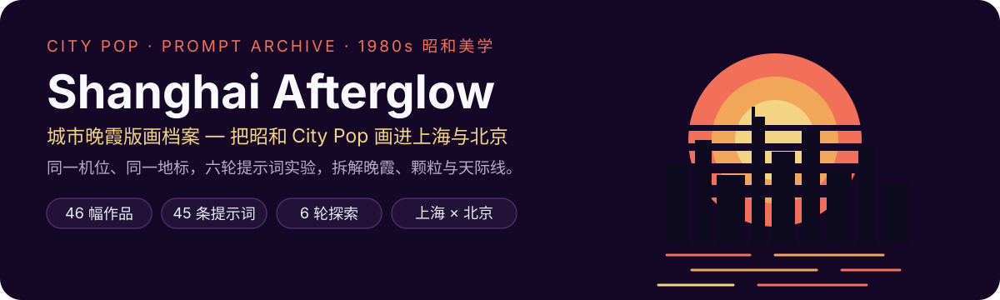
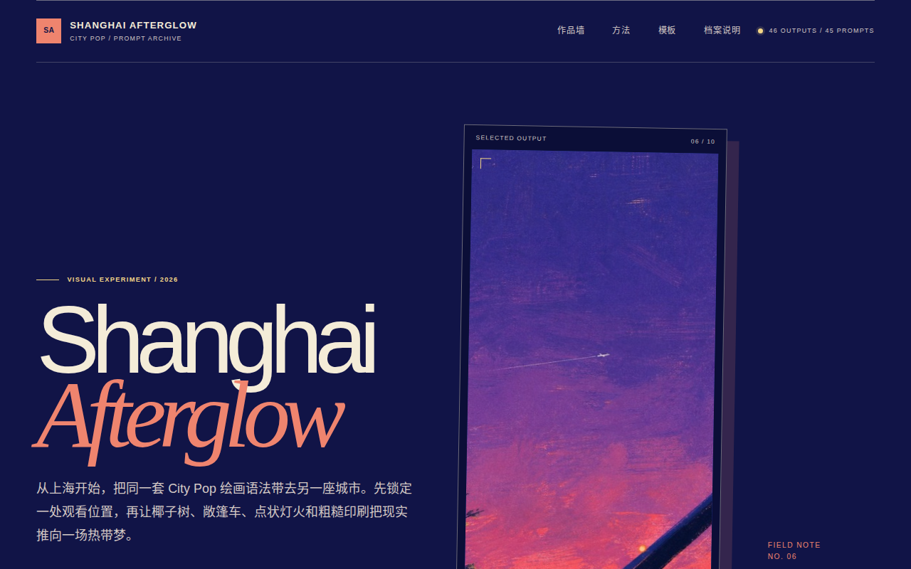
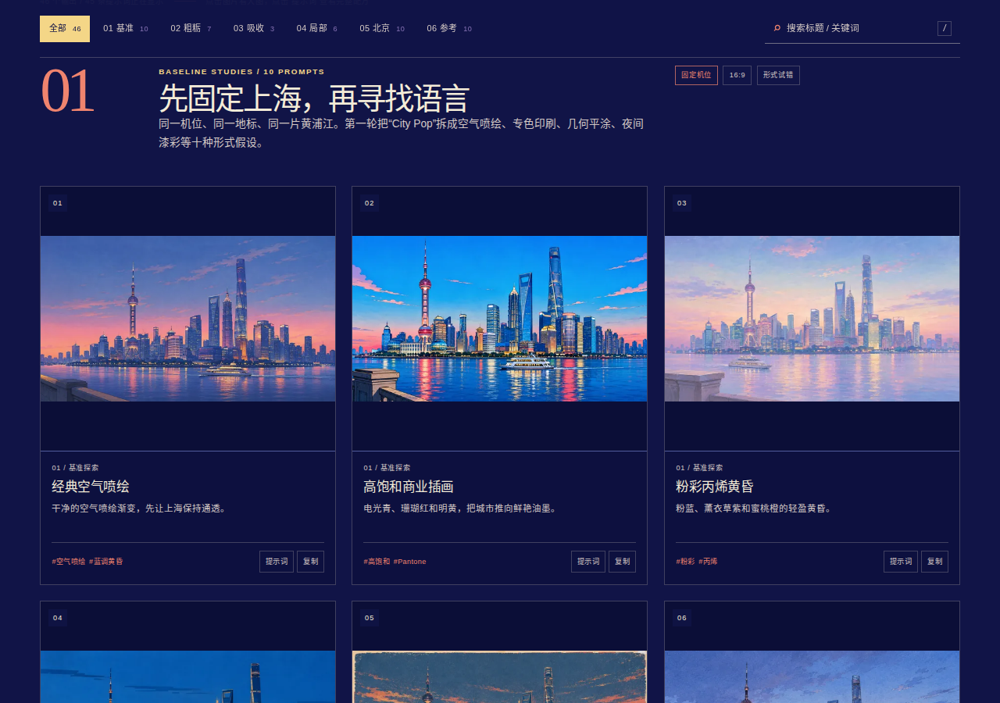

<p align="right"><a href="README.md">中文</a></p>

<p align="center">
  
</p>

<p align="center">
  <a href="https://xiaosang.cc/citypop-shanghai-exploration/">▶ View Online</a>
  ·
  <a href="https://github.com/holynova/citypop-shanghai-exploration">GitHub Repository</a>
</p>

Shanghai Afterglow is a City Pop painting prompt archive: six rounds of prompt experiments (46 artworks) translating 1980s Showa-era City Pop visuals — sunset gradients, rough-grain halftone, reflective water and city skylines — onto Shanghai and Beijing. Every artwork keeps its full structured prompt, tags and three-color palette, copyable with one click; round 6 distills the shared rules of three reference images into a reusable English prompt template.

## Screenshots

<p align="center">
  
</p>

<p align="center">
  
</p>

## Six Rounds

| Round | Theme | Works |
|---|---|---|
| 01 / 基准探索 Baseline | Same camera position, same landmark — City Pop broken into ten formal hypotheses: airbrush, spot-color print, geometric flat color, night lacquer, and more | 10 |
| 02 / 粗粝变量 Rough Variables | Palm trees, convertibles, dotted lights, rough brushwork — pulling the Bund toward a coastal resort poster | 7 |
| 03 / 规律吸收 Pattern Absorption | Absorbing the effective variables from the first two rounds | 3 |
| 04 / 局部取景 Local Framing | Back to local camera positions around Shanghai | 6 |
| 05 / 北京局部 Beijing Local | The same visual grammar moved to Beijing: ginkgo, hutongs, red walls | 10 |
| 06 / 参考规律 Reference Rules | The shared rules of three reference images distilled into a template, then back to ten local Shanghai positions | 10 |

46 artworks in total (Shanghai 36, Beijing 10), 45 prompts.

## Features

- **Filter by round, search by keyword**: a six-round filter bar plus title/keyword search.
- **Prompt popup**: click any artwork to see it large with its full prompt, flip to the previous/next piece, and copy in one click.
- **Three-color palette per artwork**: every piece carries three representative colors.
- **Reusable template**: the English prompt template distilled in round 6 (composition, palette, brushwork, negative prompts), copyable in one click.
- **Image lightbox**: view the original image fullscreen.

## Run Locally

A pure static site, no build step:

```bash
python3 -m http.server 4174 --bind 127.0.0.1
# Open http://127.0.0.1:4174
```

Or just open `index.html` in a browser. Syntax check: `npm run check` (`node --check app.js && node --check data.js`).

## Tech

- Pure HTML + CSS + JS, zero dependencies, zero build; data and presentation are separate (`data.js` holds the 46 experiment records, `app.js` renders them).
- Images in three tiers: originals in `images/`, thumbnails in `images/thumbs/` (JPG) and `images/thumbs-webp/` (WebP, preferred via `<picture>`), detail images in `images/detail-webp/`.
- Prompts are also saved as 5 JSON files: `prompts.json`, `prompts_round2.json`, `prompts_round3.json`, `prompts_round4.json`, `prompts_round5_beijing.json`.

```
index.html          Entry: homepage, artwork wall, template section, popup, lightbox
styles.css          Deep-blue background + coral sunset palette
app.js              Rendering, filtering, search, copy, popup, lightbox
data.js             46 experiment records: title, prompt, image, round
prompts*.json       5 structured prompt files
images/             Originals, thumbnails (JPG/WebP), detail images
```
