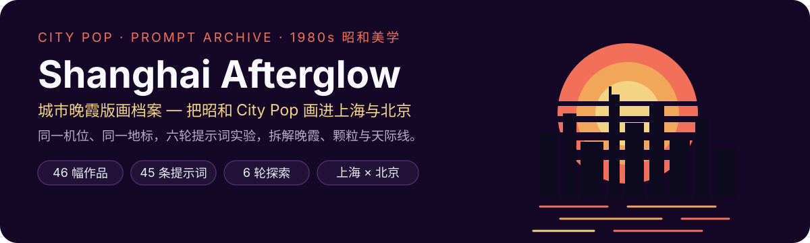
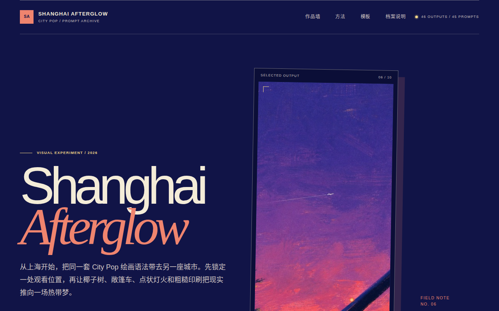
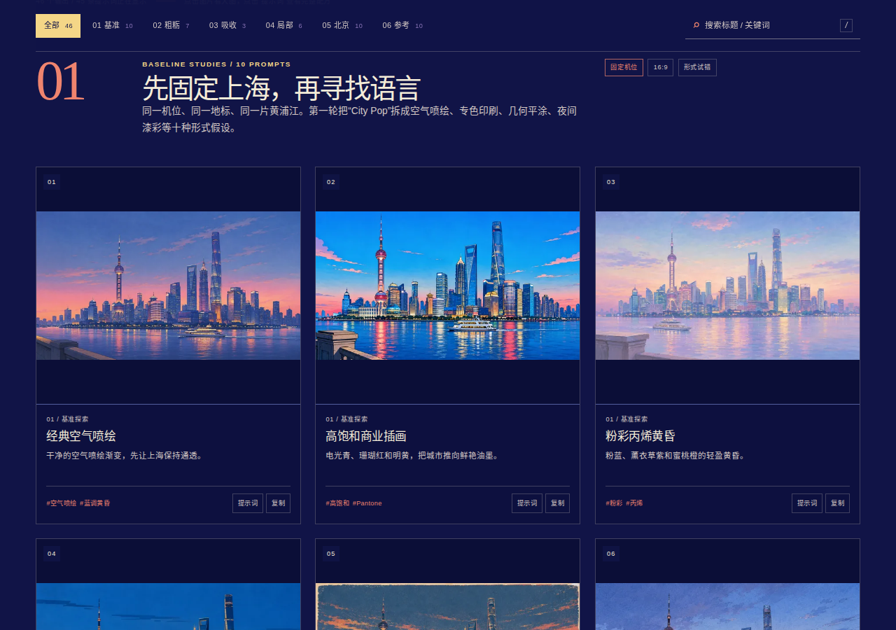

<p align="center">
  
</p>

<p align="center">
  <a href="https://xiaosang.cc/citypop-shanghai-exploration/">▶ 在线体验 Play Online</a>
  ·
  <a href="https://github.com/holynova/citypop-shanghai-exploration">GitHub 仓库</a>
</p>

Shanghai Afterglow 是一份 City Pop 绘画提示词实验档案：以上海与北京为母体，用 80 年代昭和 City Pop 的视觉语言——晚霞渐变、粗颗粒网点、反光水面与城市地标剪影——做了 6 轮、46 幅画的提示词实验。每幅画都保留完整的结构化提示词、标签与三色色板，点开即可一键复制；第六轮还把三张参考图的共同规律拆成了一份可复用的英文提示词模板。

Shanghai Afterglow is a City Pop painting prompt archive: six rounds of prompt experiments (46 artworks) translating 1980s Showa-era City Pop visuals — sunset gradients, rough-grain halftone, reflective water and city skylines — onto Shanghai and Beijing. Every artwork keeps its full structured prompt, tags and three-color palette, copyable with one click; round 6 distills the shared rules of three reference images into a reusable English prompt template.

## 截图 / Screenshots

<p align="center">
  
</p>

<p align="center">
  
</p>

## 六轮探索 / Six Rounds

| 轮次 | 主题 | 幅数 |
|---|---|---|
| 01 / 基准探索 | 同一机位、同一地标，把 City Pop 拆成空气喷绘、专色印刷、几何平涂、夜间漆彩等十种形式假设 | 10 |
| 02 / 粗粝变量 | 椰子树、敞篷车、点状灯火、粗笔触，把外滩拉向海岸度假海报 | 7 |
| 03 / 规律吸收 | 吸收前两轮的有效变量 | 3 |
| 04 / 局部取景 | 回到上海的局部机位 | 6 |
| 05 / 北京局部 | 同一套绘画语法换到北京：银杏、胡同、红墙 | 10 |
| 06 / 参考规律 | 把三张参考图的共同规律拆成模板，再回到上海的十个局部机位 | 10 |

共 46 幅作品（上海 36、北京 10），45 条提示词。

## 功能 / Features

- **按轮筛选与搜索**：六轮筛选条 + 标题/关键词搜索。
- **提示词弹窗**：点开任意作品看大图与完整提示词，支持上一张/下一张切换，一键复制。
- **每画三色板**：每幅作品附三个代表色。
- **可复用模板**：第六轮沉淀的英文提示词模板（构图、色板、笔触、负向词），一键复制。
- **图片灯箱**：全屏查看原图。

## 本地运行 / Run Locally

纯静态站，零构建：

```bash
python3 -m http.server 4174 --bind 127.0.0.1
# 打开 http://127.0.0.1:4174
```

或直接用浏览器打开 `index.html`。语法检查：`npm run check`（`node --check app.js && node --check data.js`）。

## 技术 / Tech

- 纯 HTML + CSS + JS，零依赖、零构建；数据与展示分离（`data.js` 存 46 条实验记录，`app.js` 渲染）。
- 图片三档：原图 `images/`、缩略图 `images/thumbs/`（JPG）与 `images/thumbs-webp/`（WebP，`<picture>` 首选），详情图 `images/detail-webp/`。
- 提示词另存为 5 份 JSON：`prompts.json`、`prompts_round2.json`、`prompts_round3.json`、`prompts_round4.json`、`prompts_round5_beijing.json`。

```
index.html          入口：首页、作品墙、模板区、弹窗、灯箱
styles.css          深蓝底 + 珊瑚晚霞配色
app.js              渲染、筛选、搜索、复制、弹窗、灯箱
data.js             46 条实验记录：标题、提示词、图片、轮次
prompts*.json       5 份结构化提示词文件
images/             原图、缩略图（JPG/WebP）、详情图
```

## English

**Shanghai Afterglow** is a City Pop painting prompt archive: 46 artworks across 6 rounds of experiments, translating 1980s Showa-era City Pop — sunset gradients, rough grain, reflective water, city skylines — onto Shanghai (36) and Beijing (10).

- **Six rounds**: 01 baseline (10) · 02 rough variables (7) · 03 pattern absorption (3) · 04 local framing (6) · 05 Beijing (10) · 06 reference rules (10). 45 prompts in total.
- **Every artwork keeps its full prompt**, tags and a three-color palette; click any piece to view it large with its prompt and copy it in one click.
- **Reusable template**: round 6 distills three reference images into an English prompt template (composition, palette, brushwork, negative prompts).
- **Run it**: static site, no build — `python3 -m http.server 4174` or open `index.html`.
- **Tech**: vanilla HTML + CSS + JS, zero dependencies. Images in three tiers: originals, thumbnails (JPG + WebP via `<picture>`), detail WebP.

## 许可 / License

MIT（`package.json` 声明；仓库内暂无 LICENSE 文件）。
